<div align="center">



<a href="https://github.com/Cabrly">
  
</a>

</div>


### `> whoami`

```yaml
nome:       Vitor Cabral
handle:     Cabrly
local:      Palmas — Tocantins, BR
classe:     Dev fullstack
implantes:  [JavaScript, Python, IA generativa]
missão:     transformar processo chato em ferramenta que roda sozinha
```


### `> ls ./cyberware`

<p>
  
  
  
  
  
  
  
  <br/>
  
  
  
  
</p>


### `> cat ./gigs.log`

| | gig | sinal |
|:-:|---|---|
| 🟨 | **[kaizen](https://github.com/Cabrly/kaizen)** | Kanban + planos de estudo montados por IA (Ollama local ou Gemini/ChatGPT). Roda no PC e no celular. |
| 🟦 | **[kaizen-site](https://github.com/Cabrly/kaizen-site)** | Site de divulgação do Kaizen. |
| 🟥 | **[Projeto-Naturatins](https://github.com/Cabrly/Projeto-Naturatins)** | Geração e gestão de documentos e atividades. |


<div align="center">

```diff
+ [SYS] conexão encerrada. até a próxima run, choom.
```


</div>
